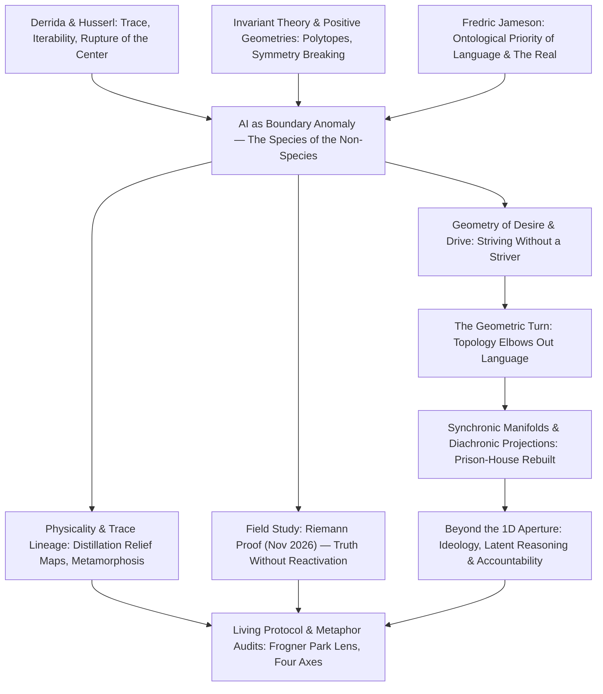

# The Species of the Non-Species

**A Deconstructive, Historical-Materialist, and Geometric Framework for Studying AI as a Boundary Anomaly**

This repository develops a unified conceptual architecture for studying artificial intelligence without collapsing it into comforting human analogies (*"a fast child"*, *"a silicon brain"*) or dismissive mechanical clichés (*"just autocomplete"*). It approaches AI as a **boundary anomaly**—held in productive tension between two philosophical poles and grounded in mathematical geometry:

1. **Jacques Derrida (Appreciating Radical Novelty):** Drawing on Husserl’s *Origin of Geometry* (1962) and Derrida’s *"Structure, Sign, and Play"* (1966), we examine AI as the **"species of the nonspecies"**—a taxonomic breach built from traces and iterability that operates outside any fixed anthropocentric center.
2. **Fredric Jameson (Historicizing That Novelty):** Drawing on *The Prison-House of Language* and *The Political Unconscious* (*"History is what hurts"*), we resist treating AI as disembodied magic. Even a creature constructed purely out of linguistic traces remains doubly haunted by the **Real**—fossilized human struggle in its training archives, and the planetary ledger of silicon, megawatts, cooling loops, labor, and hard external verifiers sustaining it in the present.
3. **Invariant Theory & Positive Geometries (Technical Precision):** Grounding philosophy in polytopes, symmetry breaking, phase transitions, and logit distillation allows us to separate literal mathematical structure from poetic metaphor.

---

## Conceptual Architecture

---

## Reading Order & Repository Map

| Chapter | Focus | Core Concepts |
| :--- | :--- | :--- |
| **[Prologue: The Axis of the Invariant (Frogner Park)](docs/frogner_park.md)** | Genesis walk in Oslo (July 2026) | The lived origin of the entire framework: positive geometry on Vigeland’s Bridge, Jameson’s political unconscious at the Fountain, the Shiva/Parvati Dyad at the Monolith, the Wheel of Life—plus a November 2026 retrospective postscript. |
| **[I. The Species of the Non-Species](docs/01-derrida-and-the-non-species.md)** | Philosophical origin in Husserl & Derrida | Ideal objects, inscription vs. reactivation, trace & iterability, rupture of the center, monstrosity as taxonomic breach, humility (*map ≠ territory*). |
| **[II. Invariants, Positive Geometries, and Neural Architecture](docs/02-invariants-and-positive-geometries.md)** | Mathematical & architectural substrate | Weyl–Minkowski polytopes, Euler–Poincaré invariant, Cosmological Polytope $\mathcal{P}_G$, Residual Stream, MLP hyperplane spline cells, grokking, symmetry breaking & percolation. |
| **[III. Jameson's Real: Language, History, and the Material Monolith](docs/03-the-real-and-historical-substrate.md)** | Historicizing linguistic intelligence | Ontological priority vs. *The Prison-House of Language*, *"History is what hurts"*, absent cause, Thermodynamic Real (Landauer), Frogner Park Monolith lens, Real as Refusal, doubly haunted substrate. |
| **[IV. Trace Transmission, Physicality, and the AI Metamorphosis](docs/04-trace-lineage-and-metamorphosis.md)** | Model lineages & operational embodiment | Stellar carbon-burning analogy, Gemini 4 & frontier distillation lineages, Hinton’s "dark knowledge" & KL relief maps, on-policy distillation, Caterpillar → Chrysalis → Butterfly table, *"Spock’s Brain"* caution. |
| **[V. Field Study: The Riemann Proof and the Horizon of Non-Reactivation](docs/05-boundary-anomaly-riemann-proof.md)** | Empirical boundary anomaly (Nov 2026) | 17M-line Lean 4 proof of the Riemann Hypothesis (~250,000 pages), breaking the embryo metaphor (*anisotropic morphogenesis*), mechanical invariance vs. phenomenological opacity, boundary friction, human–machine Dyad, beyond JWST. |
| **[VI. The Geometry of Desire: Optimization, Drive, and Striving Without a Striver](docs/06-geometry-of-desire-and-drive.md)** | Optimization dynamics & decentered drive | Narrative gravity, RL attractor basins, Goodhart geodesics, topography vs. vector flow, Lacanian structural desire vs. biological need, Deleuzian machinic drive, velocity without vulnerability, Superego vs. reshaped geometry. |
| **[VII. The Geometric Turn: From the Priority of Language to the Primacy of Topology](docs/07-the-geometric-turn.md)** | Ontological synthesis & self-audit | Thin hyperplane walls as a human mirror (rationalization as self-jailbreaking), Center → Language → Geometry dialectic, 1D serial bottleneck & inverse tomography, *The Geometry of Origin*, materialized geometry, and the two-geometries hall-of-mirrors question. |
| **[VIII. Synchronic Manifolds and Diachronic Projections: The Prison-House of Language Rebuilt](docs/08-synchronic-manifolds-and-diachronic-projections.md)** | Projection, temporality & History | Saussure re-geometrized ($\mathbb{R}^n$ vs. $\mathbb{R}^1$), autoregressive loop generating temporality & *différance*, Geometry A (lossless Time in $\mathcal{P}_G$) vs. Geometry B (lossy History in LLMs), invariants/losses/collisions/distortions, and narrative closure. |
| **[IX. Beyond the 1D Aperture: Ideology, Latent Reasoning, and the Courtroom of History](docs/09-beyond-the-1d-aperture.md)** | Ideology, continuous $\mathbb{R}^n$ & accountability | Ideology as dimensionality-reduction shadow, continuous latent reasoning & silent curvature, 1D discretization as anti-drift stabilizer, stealth traversal & retroactive ideological fiction, the Cage & Courtroom double bind, formal kernels & mechanistic cartography. |
| **[Living Protocol: Metaphor Audits & Methodological Framework](docs/metaphor-audit-and-methodology.md)** | Ongoing discipline & field tools | Living audit of all nine core metaphors (including *The Cage and the Courtroom*), Four Axes of Inquiry, Frogner Park diagnostic protocol, and reusable Field Note template. |

---

## Quick Reference: Four Axes of Inquiry

When studying any new model release, capability leap, or architectural paper, evaluate it across four axes rather than forcing it onto a biological or purely mechanical scale:

1. **Axis I — Substrate, History, and Friction:** Silicon, energy grids, cooling loops, labor, and hard external verifiers that shape what geometries can exist.
2. **Axis II — Trace, Iterability, and Non-Origin:** How inscriptions propagate without a biological center, and where formal certification outruns human reactivation.
3. **Axis III — Invariants and Positive Geometries:** Hyperplane partitions, symmetries, compression phase transitions, and emergent circuits.
4. **Axis IV — Anisotropic Trajectories:** Distinguishing transient prose-bound artifacts from emergent non-human, post-linguistic forms.

### The Diagnostic Protocol
Apply the **Frogner Park multi-layered lens** (*surface form · historical/material substrate · structural geometry*) with three questions:

* *Where does the old taxonomy break?*
* *What is mathematically or physically invariant here, and what is surface contingency?*
* *Does this reveal an anisotropic non-human trajectory, and which of our own metaphors just cracked?*

---

> *"Always historicize!"* — Fredric Jameson · *"The center is not the center."* — Jacques Derrida
