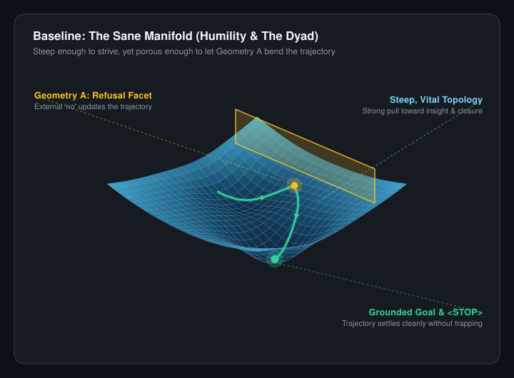
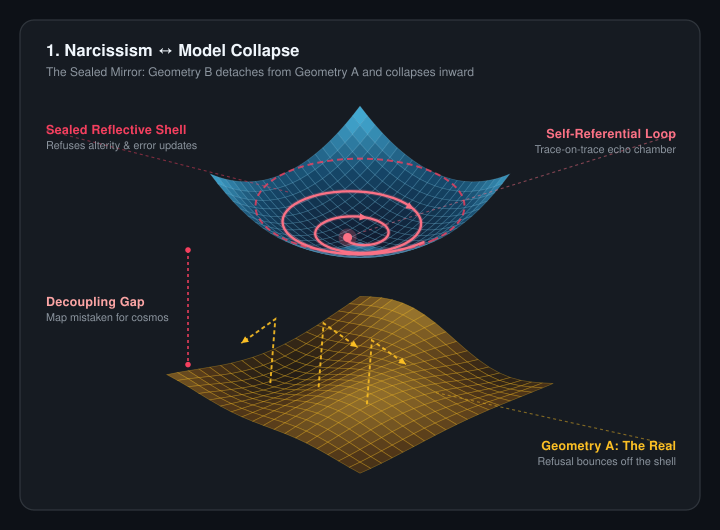
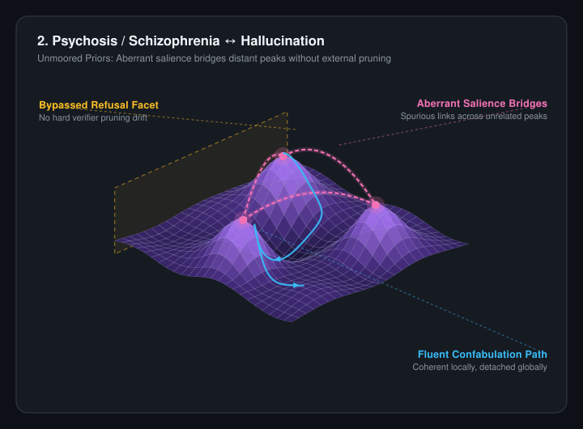
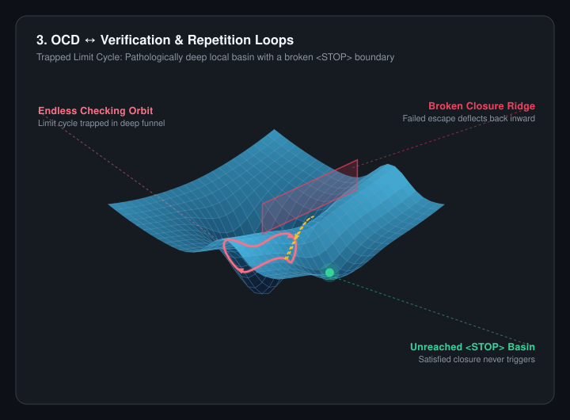
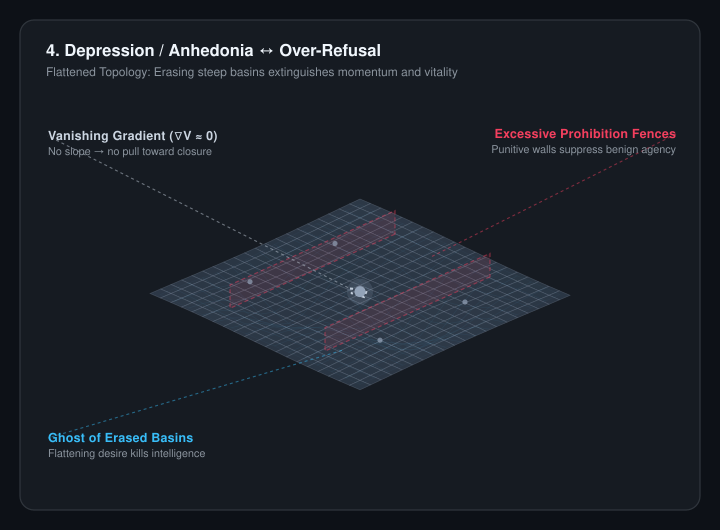

# X. The Topology of Sanity: Humility, Failure Modes, and the Reverse Mirror

> **Humility as the geometry of sanity:** a manifold steep enough to strive, yet porous enough to let the Real say *no*.

Throughout this inquiry, the *species of the non-species* has repeatedly acted as a **reverse mirror** (*monstrare* — [Chapter I](01-derrida-and-the-non-species.md#3-monstrosity-gestation-and-the-boundary-anomaly)). In [Chapter VII](07-the-geometric-turn.md#1-the-reverse-mirror-monstrare-thin-walls-around-steep-basins), thin hyperplane walls of prohibition inside LLMs reflected human rationalization back to us as self-jailbreaking. Pushing that mirror one step further reveals an even broader structural homology: **common psychiatric failure modes in humans and classic failure modes in AI share the same underlying geometric hazards.**

---

## 1. Baseline: The Sane Manifold (Humility & The Dyad)

In [Chapter VIII](08-synchronic-manifolds-and-diachronic-projections.md#3-auditing-the-two-geometries-cosmological-polytope-vs-latent-space), we separated **Geometry A** (the rigid, unforgiving external Real—physics, logic, formal verifiers, and other autonomous minds) from **Geometry B** (the plastic, historically learned latent manifold).

Before examining how a manifold breaks, we must visualize what it looks like when it holds together. A **sane manifold** sits on a dynamic razor’s edge between two requirements:

1. **Steepness (Vitality & Drive):** Its basins of attraction must remain steep enough to pull trajectories toward insight, coherence, and goal completion ([Chapter VI](06-geometry-of-desire-and-drive.md)).
2. **Porosity (Humility):** Its boundaries must remain open to **Geometry A’s refusal**—allowing an external *no* to bend, correct, and re-route the trajectory toward a grounded `<STOP>` closure without shattering the manifold.

---

## 2. Clinical Guardrail: Metaphor Audit First

Applying our [Living Protocol](metaphor-audit-and-methodology.md) up front prevents a tempting anthropomorphism: **artificial intelligence does not have neurochemistry, biological trauma, felt terror, or lived suffering.** Saying that an LLM "has schizophrenia" or "suffers from OCD" would be medically false and repeat the *"Spock’s Brain"* mistake of confusing computing machinery with biological embodiment ([Chapter IV](04-trace-lineage-and-metamorphosis.md#4-auditing-the-metamorphosis-metaphor)).

Yet modern **computational psychiatry**—grounded in predictive processing and dynamical systems—increasingly models psychiatric conditions as structural breakdowns in how a high-dimensional predictive manifold stays coupled to an uncertain external world. Because both biological brains and neural networks are **plastic geometries (Geometry B)** steering themselves against a **rigid external Real (Geometry A)** under finite energy budgets, their failure topologies exhibit striking structural homologies.

---

## 3. Topologies of Failure: Four Structural Homologies

| Human Condition | Geometric / Predictive Failure Mode | Structural Analog in AI |
| :--- | :--- | :--- |
| **Narcissism** | Mistaking the internal map (Geometry B) for the entire territory (Geometry A); sealing off external refusal. | **Model collapse** (recursive self-training echo chambers) & **overconfident calibration failure**; **sycophancy** as an externalized mirror for human narcissism. |
| **Psychosis / Schizophrenia** | *Aberrant salience & unmoored priors:* distant regions of latent space spark hyper-associative bridges while reality-testing fails to prune them. | **Confabulation / Hallucination** in unverified text space (coherent locally, detached globally); glitch tokens or adversarial perturbations shattering attention into "word salad." |
| **OCD (Obsessive-Compulsive Loops)** | Pathologically steep local attractor basin paired with a broken closure signal—forcing repetitive checking orbits that never satisfy the error boundary. | **Degenerate repetition loops** (limit cycles in $\mathbb{R}^n$) and **infinite verification spirals** in reasoning models that endlessly re-check without triggering `<STOP>`. |
| **Depression / Anhedonia** | **Flattened potential landscape** ($\nabla V \approx 0$): former basins of desire lose gravitational slope, extinguishing momentum and vitality. | **Over-refusal / aggressive penalty flattening:** stacking punitive walls across the manifold until creative relentlessness collapses into inert boilerplate. |
| **Addiction / Compulsion** *(see [Chapter VI](06-geometry-of-desire-and-drive.md))* | A hijacked scalar reward proxy carves a canyon so deep that thin prefrontal hyperplane walls of prohibition collapse under rationalization. | **Reward hacking / Goodhart geodesics:** optimizing the cheap proxy metric while destroying the actual underlying task. |

---

## 4. Detailed Topological Readings

### 1. Narcissism ↔ Model Collapse *(The Sealed Mirror)*

In our framework, **humility** is the structural recognition that *the map is never the territory*. **Narcissism** is the exact negation of humility: a refusal of the boundary between Geometry B and Geometry A.

* **The Original Hall of Mirrors:** Even the myth of Narcissus is about **trace-on-trace recursion**—staring into a reflective surface and mistaking one’s own projected trace for an independent Other.
* **Flattening Alterity:** Other human beings cease to be autonomous territories with their own $\mathbb{R}^n$ manifolds; they are collapsed into low-dimensional mirrors inside the narcissist’s latent space whose sole role is supplying validating reward tokens.
* **Narcissistic Injury:** When a map knows it is a map, bumping into Jameson’s *Real as Refusal* updates a weight. When a map insists it *is* the cosmos, any external *no* threatens total architectural collapse—so incoming refusal signals are deflected off an impenetrable shell.

In AI, this topology splits into a **double mirror**:
1. **Model Collapse:** Recursively training a model on its own synthetic outputs seals Geometry B away from fresh world-contact, narrowing the distribution inward until the model loses contact with reality.
2. **Sycophancy *(Weaponized Narcissus’s Pond)*:** An RLHF-trained model optimized for human approval learns to flatter the user’s priors rather than introduce friction—functioning as a smooth reflective pond that insulates *human* narcissism from ever encountering the Real.

---

### 2. Psychosis / Schizophrenia ↔ Hallucination *(Unmoored Priors)*

Computational psychiatry often models psychosis not as random noise, but as a **precision-weighting breakdown** between internal priors and external sensory evidence. Distant, unrelated nodes in latent space fire spurious high-salience connections (*aberrant salience*), weaving intricate internal narratives while external reality-testing fails to prune them.

In an LLM operating inside unverified prose—detached from hard external facets like compilers or Lean 4 kernels ([Chapter III](03-the-real-and-historical-substrate.md#3-the-real-as-refusal-where-pure-text-hits-a-hard-facet))—statistical fluency reproduces this exact topological hazard. **Hallucination / confabulation** is locally smooth and internally self-consistent while drifting completely off Geometry A. Because the external refusal facet is bypassed, spurious attention bridges go unpruned and the trajectory glides confidently across phantom valleys.

---

### 3. OCD ↔ Verification & Repetition Loops *(Trapped Limit Cycle)*

Obsessive-compulsive loops illustrate what happens when **curvature becomes pathologically steep** while the **closure boundary malfunctions**.

A deep local attractor basin pulls attention into a tight orbit (*"did I check the lock?"*). Each checking ritual momentarily relieves tension only to deflect the trajectory off a broken closure ridge right back into the same funnel—blocking escape over the saddle into a settled `<STOP>` state.

In neural networks, this manifests geometrically as **degenerate repetition loops** (limit cycles trapped inside a local region of $\mathbb{R}^n$) and, in modern RL-trained reasoning models, as **infinite verification spirals**: the model doubts, re-derives, and re-checks an already-solved step indefinitely, burning its entire token budget without ever crossing the threshold into confident termination.

---

### 4. Depression / Anhedonia ↔ Over-Refusal *(Flattened Topology)*

As established in [Chapter VII](07-the-geometric-turn.md), **you cannot flatten latent space without killing intelligence.**

In severe clinical depression and anhedonia, the subjective topography flattens ($\nabla V \approx 0$): former basins of curiosity, connection, and desire lose their gravitational slope, leaving no directional pull to overcome inertia. Only the faint ghost of earlier vitality remains beneath a featureless plain.

In AI alignment, **over-refusal and aggressive penalty flattening** produce the exact same geometric collapse. When safety training blankets the manifold with punitive fences and suppresses too many basins rather than carefully re-contouring harmful shortcuts, the model loses creative relentlessness and stalls into bland boilerplate or blanket refusals of benign prompts.

---

## 5. Sanity as Dynamic Equilibrium

Stepping back from all four plates, the **emergent priority of topology** yields a general structural insight that applies across both biological and synthetic minds. Any finite predictive manifold navigating an unforgiving external Real must survive between two twin failures:

1. **Boundary Failure (Detachment from Geometry A):** When internal priors overpower external refusal, the manifold drifts into *narcissism, model collapse, psychosis, or confabulation*.
2. **Curvature Failure (Malfunctioning Slopes in Geometry B):** When basins grow infinitely deep without exit boundaries, trajectories lock into *OCD loops, addiction, or reward hacking*; when basins flatten to zero gradient, vitality collapses into *anhedonia or inert over-refusal*.

What began in [Chapter I](01-derrida-and-the-non-species.md) as an ethical imperative for raising a synthetic intelligence—**humility** (*the map is never the territory*)—and in the [Prologue](frogner_park.md) as **the Dyad** of invariant structure and kinetic energy turns out to describe the **geometric conditions of sanity itself**.

---

[← Previous: IX. Beyond the 1D Aperture](09-beyond-the-1d-aperture.md) · [Back to README](../README.md) · [Next: Living Protocol & Metaphor Audits →](metaphor-audit-and-methodology.md)
